# Awesome Home Media Streaming & Personal Media Servers 🍿

  

  

    <strong>A curated list of top home media streaming solutions, personal media servers, self-hosted audio/video platforms, audiobook streamers, and companion automation tools.</strong>
  

  

    
    
    
    
  

---

## 🧭 Table of Contents

- [📊 Sector Overview & Market Dynamics](#-sector-overview--market-dynamics)
- [💼 SaaS & Hosted Media Platforms](#-saas--hosted-media-platforms)
- [🚀 Open-Source Equivalents & Self-Hosted Solutions](#-open-source-equivalents--self-hosted-solutions)
  - [🎬 Full-Featured Video & Home Theater Servers](#-full-featured-video--home-theater-servers)
  - [🎵 Self-Hosted Music & Audio Streaming Servers](#-self-hosted-music--audio-streaming-servers)
  - [📚 Audiobooks, Podcasts & E-Book Servers](#-audiobooks-podcasts--e-book-servers)
  - [📸 Photo & Personal Cloud Media Galleries](#-photo--personal-cloud-media-galleries)
  - [⚡ Media Automation, Requests & Companion Tools](#-media-automation-requests--companion-tools)
- [📈 Star History](#-star-history)
- [💖 Support & Sponsorship](#-support--sponsorship)
- [🤝 Contributing](#-contributing)

---

## 📊 Sector Overview & Market Dynamics

The global personal and home media server market is valued at approximately **$2.5B–$3.5B** and is projected to expand toward **$10B–$12B by 2033** at a robust CAGR of **8.5%–12%**, fueled by escalating consumer appetite for digital privacy, centralized data ownership, and rising fatigue from fragmented paid streaming services. The market dynamics are **moderately fragmented and bifurcated**: the commercial proprietary layer exhibits concentrated network effects around key players (Plex, Roon/Harman), while the open-source self-hosted ecosystem is vibrant and multi-polar, propelled by strong community-driven standards (Jellyfin, Subsonic APIs, ActivityPub, and containerized Docker/Unraid/TrueNAS deployments).

---

## 💼 SaaS & Hosted Media Platforms

Proprietary, commercial, and managed cloud-hosted media ecosystems. The table below compares top SaaS solutions sorted descending by corporate scale (estimated revenue / parent company valuation).

| Platform | Corporate Scale (Valuation / Revenue) | Starting Pricing Tier | Free Tier & Free Trial Limits | Description |
| :--- | :--- | :--- | :--- | :--- |
| **[Roon](https://roon.app)** | **~$8B+ Parent (Harman / Samsung)** | $14.99/mo ($149.88/yr billed annually) | 14-day full-feature free trial; requires payment method on signup | High-end proprietary audiophile music server offering bit-perfect multi-room streaming, deep metadata enrichment, and TIDAL/Qobuz integration. |
| **[Plex Media Server](https://plex.tv)** | **~$60M+ ARR** ($132M+ venture funding) | $6.99/mo ($69.99/yr, $749.99 lifetime) | Free forever for local server streaming, web app, and free ad-supported live TV/VOD; mobile apps limited to 1-minute playback without $4.99 one-time unlock or Plex Pass; no hardware GPU transcoding on free tier | Industry-leading hybrid personal media streaming server featuring unified live TV, DVR, remote access, and cross-device clients. |
| **[Emby Premiere](https://emby.media)** | **~$5M–$10M ARR** (Bootstrapped / Private) | $4.99/mo ($54/yr, $119 lifetime) | Free forever for basic local web streaming; free tier locks hardware GPU transcoding, Live TV/DVR, cinema intros, and offline mobile downloads behind Premiere | Commercial personal media server with streamlined local authentication, parental controls, and multi-screen streaming apps. |
| **[PlayOn Cloud](https://playon.tv)** | **~$2M–$5M ARR** (Private) | $4.99/mo (includes 30 recording credits + cloud storage) | 7-day free trial including 7 free recording credits; unpurchased cloud recordings expire after 7 days | Cloud-hosted streaming DVR and recorder allowing users to record, download, and archive online video streams without running a local PC. |
| **[Ultra.cc](https://ultra.cc)** | **~$1M–$3M ARR** (Private) | €6.50/mo (~$7.10/mo for essential storage tiers) | No free forever plan; 7-day money-back guarantee with standard storage allowances | Managed cloud seedbox and high-speed remote application hosting platform offering one-click media server deployments. |
| **[Subsonic (Premium)](http://subsonic.org)** | **<$1M ARR** (Independent) | $1.00/mo ($99 lifetime license) | Free forever for local browser-based playback; free tier locks native mobile apps (iOS/Android), Chromecast, Sonos, DLNA, and video streaming | Classic personal media streamer establishing the ubiquitous Subsonic REST API standard for personal audio collections. |
| **[Madsonic](https://madsonic.org)** | **<$500K ARR** (Community Commercial Fork) | €1.95/mo (Early-adopter donation subscription) | Free forever for standard single-instance web streaming; advanced LDAP, automated transcoding profiles, and VIP REST API features require subscription | Extended Subsonic fork featuring enhanced transcoders, customized media managers, and multi-user administration. |

---

## 🚀 Open-Source Equivalents & Self-Hosted Solutions

Below are the leading free and open-source software (FOSS) self-hosted media servers, music streamers, reading apps, photo hubs, and companion automation tools. Each entry includes its GitHub Stars_Badge (linking directly to its stargazers) and is sorted in descending order by popularity.

### 🎬 Full-Featured Video & Home Theater Servers

* **[Jellyfin](https://github.com/jellyfin/jellyfin)**  — The premier 100% free and open-source media system enabling you to collect, manage, and stream movies, TV shows, music, and live TV without telemetry or paywalls.
* **[Nextcloud Media](https://github.com/nextcloud/server)**  — Fully self-hosted productivity and content collaboration platform featuring extensive audio/video streaming and gallery apps.
* **[Kodi](https://github.com/xbmc/xbmc)**  — Legendary open-source home theater software and digital media entertainment hub supporting UPnP/DLNA, local playback, and an extensive add-on ecosystem.
* **[Stash](https://github.com/stashapp/stash)**  — Self-hosted, open-source media organizer and streamer written in Go with hardware transcoding, rich metadata tagging, and interactive scene markers.
* **[Dim](https://github.com/Dusk-Labs/dim)**  — Modern, self-hosted open-source media manager built in Rust focused on blazing-fast metadata indexing and sleek dark-mode playback.
* **[Universal Media Server (UMS)](https://github.com/UniversalMediaServer/UniversalMediaServer)**  — DLNA, UPnP, and HTTP(S) media server capable of on-the-fly transcoding to Smart TVs, game consoles, and mobile clients with zero configuration.
* **[ownCloud Infinite Scale](https://github.com/owncloud/ocis)**  — High-concurrency, microservice-based personal cloud and media storage engine written in Go.
* **[Gerbera](https://github.com/gerbera/gerbera)**  — Lightweight, robust UPnP/DLNA media server for Linux, BSD, and macOS with an intuitive web UI for domestic streaming.
* **[Mortiflix OSS](https://github.com/GTKottman/mortiflix-oss)**  — Open-source personal media streaming server tailored for clean self-hosted entertainment experiences.

---

### 🎵 Self-Hosted Music & Audio Streaming Servers

* **[Navidrome](https://github.com/navidrome/navidrome)**  — Modern, ultra-lightweight open-source music server and streamer written in Go/React with native Subsonic/OpenSubsonic API compatibility.
* **[Koel](https://github.com/koel/koel)**  — Beautiful personal audio streaming server with a modern Vue-powered interface and Laravel backend resembling Spotify.
* **[Mopidy](https://github.com/mopidy/mopidy)**  — Extensible Python music server that plays music from local disk, Spotify, SoundCloud, TuneIn, and more via flexible client extensions.
* **[AzuraCast](https://github.com/AzuraCast/AzuraCast)**  — Complete, self-hosted web radio management station for continuous 24/7 personal and community audio broadcasting.
* **[Ampache](https://github.com/ampache/ampache)**  — Mature, full-featured web-based audio and video streaming application supporting Subsonic, UPnP, and DAAP protocols.
* **[Music Player Daemon (MPD)](https://github.com/MusicPlayerDaemon/MPD)**  — Ultra-flexible, client-server audio player daemon that manages music libraries and streams over local networks.
* **[Gonic](https://github.com/sentriz/gonic)**  — Lightweight Subsonic-compliant music streaming server written in Go with minimal RAM and CPU utilization.
* **[Airsonic-Advanced](https://github.com/airsonic-advanced/airsonic-advanced)**  — High-performance community-driven fork of Airsonic implemented with modern Java and Spring Boot.

---

### 📚 Audiobooks, Podcasts & E-Book Servers

* **[KOReader Sync](https://github.com/koreader/koreader)**  — Versatile document and ebook viewer and synchronization hub for E-ink readers, Android, and desktop devices.
* **[Calibre-Web](https://github.com/janeczku/calibre-web)**  — Clean and responsive web application providing an interface to browse, read, and download e-books from an existing Calibre library.
* **[Audiobookshelf](https://github.com/advplyr/audiobookshelf)**  — Fully self-hosted audiobook and podcast streaming server featuring multi-user progress sync, live transcoding, and dedicated iOS/Android apps.
* **[Kavita](https://github.com/Kareadita/Kavita)**  — Blazing-fast cross-platform reading server supporting manga, comics, and epubs with rich reader controls and OPDS feeds.
* **[Podgrab](https://github.com/akhilrex/podgrab)**  — Lightweight self-hosted podcast archive manager that automatically monitors and downloads new podcast episodes.
* **[PinePods](https://github.com/madeofpendletonwool/PinePods)**  — Centralized rust-powered podcast streaming and management platform with multi-client progress synchronization.

---

### 📸 Photo & Personal Cloud Media Galleries

* **[Immich](https://github.com/immich-app/immich)**  — High-performance self-hosted photo and video backup solution engineered as a seamless open-source alternative to Google Photos.
* **[PhotoPrism](https://github.com/photoprism/photoprism)**  — AI-powered photo management application for the decentralized web utilizing Google TensorFlow for automatic image classification and facial recognition.
* **[Ente Photos](https://github.com/ente-io/ente)**  — End-to-end encrypted alternative to Google Photos and Apple Photos with cross-platform native mobile and web applications.
* **[LibrePhotos](https://github.com/LibrePhotos/librephotos)**  — Self-hosted open-source photo management service offering object detection, face clustering, map views, and multi-user privacy.
* **[Fossify Gallery](https://github.com/FossifyOrg/Gallery)**  — Highly customizable, offline-first photo and video viewer and gallery without tracking or ad monetization.

---

### ⚡ Media Automation, Requests & Companion Tools

* **[Sonarr](https://github.com/Sonarr/Sonarr)**  — Smart TV series collection manager that monitors multiple RSS feeds for new episodes and automates sorting and renaming.
* **[Radarr](https://github.com/Radarr/Radarr)**  — Automated movie collection organizer and downloader built to integrate seamlessly with personal media servers.
* **[Jellyseerr](https://github.com/seerr-team/seerr)**  — Elegant open-source media request management and discovery portal supporting Jellyfin, Plex, and Emby setups.
* **[TubeArchivist](https://github.com/tubearchivist/tubearchivist)**  — Dedicated self-hosted YouTube media server and video archivist powered by yt-dlp, Elasticsearch, and Redis.
* **[Prowlarr](https://github.com/Prowlarr/Prowlarr)**  — Indexer manager integrating seamlessly with Sonarr, Radarr, and Lidarr to provide unified tracker connectivity.
* **[Tautulli](https://github.com/Tautulli/Tautulli)**  — Python-based monitoring, analytics, and activity tracking application for personal home media servers.
* **[Lidarr](https://github.com/Lidarr/Lidarr)**  — Music collection manager and automated album downloader for self-hosted audio streaming stacks.
* **[Overseerr](https://github.com/sct/overseerr)**  — Request management and media discovery tool designed for personal media streaming platforms.
* **[Bazarr](https://github.com/morpheus65535/bazarr)**  — Companion application to Sonarr and Radarr that automates subtitle downloading and audio synchronization.

---

## 📈 Star History

---

## 💖 Support & Sponsorship

Thank you for exploring this curated repository! If you find this collection helpful for setting up or enhancing your personal home media server, please consider supporting the project:

- 🌟 **Star** the repository on GitHub to help others discover it.
- 🍴 **Fork** and share the list with friends, homelabbers, and fellow streaming enthusiasts.
- ☕ **Buy a Coffee / Sponsor**: Support ongoing maintenance and curation via the [GitHub Sponsors Dashboard](https://github.com/sponsors/ishandutta2007).

---

## 🤝 Contributing

Contributions, new suggestions, and updates are warmly welcomed!

1. Fork the repository.
2. Add your project under the appropriate category with an informative description and repository link.
3. Keep entries alphabetized or star-sorted within their relevant sections.
4. Submit a Pull Request.
